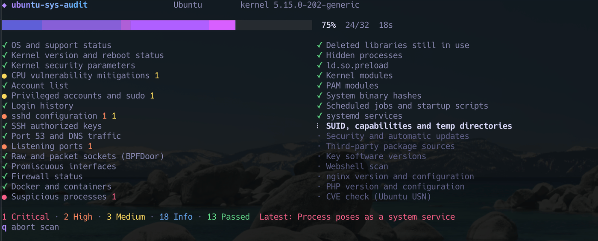

# ubuntu-sys-audit

English | [繁體中文](README.zh-TW.md)

A read-only security audit tool for Ubuntu 18.04, 20.04, 22.04, 24.04 and 26.04. It ships as a single static binary: download it and run it with sudo. The target host needs no compiler and no extra packages.




## Usage

```sh
curl -fsSLO https://github.com/guanting112/ubuntu-sys-audit/releases/latest/download/ubuntu-sys-audit-linux-amd64
curl -fsSLO https://github.com/guanting112/ubuntu-sys-audit/releases/latest/download/SHA256SUMS
sha256sum --ignore-missing -c SHA256SUMS
chmod +x ubuntu-sys-audit-linux-amd64
sudo ./ubuntu-sys-audit-linux-amd64
```

On ARM hosts, replace `amd64` with `arm64`.

### Scanning multiple hosts

The tool writes JSON automatically when there is no TTY, so you can collect reports over SSH:

```sh
for h in web-01 web-02 db-01; do
  ssh "$h" 'sudo ./ubuntu-sys-audit-linux-amd64' > "audit-$h.json"
  echo "$h exit=$?"
done
```

This requires passwordless sudo on the host. If sudo asks for a password, allocate a TTY and save the report to a file, then fetch it. A TTY would otherwise mix the password prompt into stdout:

```sh
ssh -t "$h" 'sudo ./ubuntu-sys-audit-linux-amd64 --json -o audit.json > /dev/null'
scp "$h:audit.json" "audit-$h.json"
```

The report has mode 0600 and its owner is set back to the user who ran sudo, so scp can fetch it directly.

Use the exit code to decide what to do next:

| Code | Meaning |
| --- | --- |
| 0 | Nothing to act on |
| 1 | Medium findings |
| 2 | Critical or high findings |
| 130 | Scan was aborted |

### Options

| Option | Description |
| --- | --- |
| `--json` | Write JSON to stdout without opening the TUI |
| `--text` | Write plain text to stdout without opening the TUI |
| `--min-severity LV` | In text mode, list only this level and above: `critical`, `high`, `medium`, `info`, `ok`, `skipped` (default `medium`) |
| `-o, --output FILE` | Also save the JSON report to FILE (mode 0600) |
| `--offline` | Do not use the network. CVEs are not checked unless `--oval-file` is given |
| `--oval-file PATH` | Use a local OVAL file (`.xml` or `.xml.bz2`) |
| `--proxy URL` | HTTP proxy for downloading advisory data |
| `--skip-fs` | Skip the full filesystem scan |
| `--fs-timeout TIME` | Time limit for the full filesystem scan (default `5m`) |
| `--no-netlink` | Do not read BPF filters, which keeps the kernel from loading `packet_diag` |
| `--version` | Show the version |

### TUI keys

`↑↓` or `jk` move · `tab` switch pane · `f` filter by severity · `/` search · `s` save JSON to the current directory · `q` quit

## What it checks

| Category | Coverage |
| --- | --- |
| CVE | Installed packages and the running kernel against Ubuntu Security Notices (USN), including fixes available only through ESM |
| Web | nginx and PHP versions and origin; non-Ubuntu builds against nginx.org and php.net; common dangerous settings; webshell signatures; PHP files in upload directories |
| Network | Port 53 listeners and their owners, traffic to DNS servers the system is not configured to use, all listening ports, packet and raw sockets, BPFDoor magic values, promiscuous mode, Docker |
| Processes | Processes posing as kernel threads or system services, execution from temporary directories or memory, reverse shells, shells under web services, crypto miners, LD_PRELOAD, hidden processes, libraries replaced on disk but still in use |
| Integrity | System binaries against dpkg hashes, `ld.so.preload`, hidden kernel modules, unsigned modules, PAM modules and configuration, `core_pattern`, the `modprobe` path |
| Persistence | cron, at, rc.local, init.d, profile, motd, apt hooks, udev, systemd services, login scripts in home directories |
| Accounts | Account count and list, UID 0 accounts, empty passwords, sudo rules, privileged groups, login history, SSH brute force attempts |
| SSH | Effective `sshd_config` settings, authorized keys with fingerprints, keys on system accounts, host key permissions |
| Filesystem | SUID and SGID files, capabilities, executables in temporary directories, regular files in `/dev`, world-writable system files, system binaries not managed by a package |
| Packages | Pending security updates, stale apt lists, automatic updates, apt holds, third-party sources, versions of key software |
| System | Release support dates and ESM, kernel version, pending reboots, kernel security parameters, CPU vulnerability mitigations |

## Design principles

**Read-only.** The tool writes no files unless you pass `-o` or press `s`. Although it runs as root, it never executes a program from the host. Versions are read from the contents of binaries instead of running `nginx -v`. `test/e2e/run.sh` verifies this with strace.

Known exception: when the tool reads BPF filters, the kernel may automatically load the `packet_diag` module, the same effect as running `ss -0`. The report says so when this happens, and `--no-netlink` turns it off.

**Outbound traffic only downloads public data.** The tool connects to `security-metadata.canonical.com`, `nginx.org` and `www.php.net` using plain GET requests that send no information about the host. It contacts nginx.org and php.net only when it finds non-Ubuntu builds.

**CVE checks do not rely on version numbers alone.** Ubuntu backports fixes to older versions, so `nginx 1.18.0` may already be patched. Apt packages are always compared against Canonical's OVAL data. Only self-compiled, upstream repository and PPA builds are compared against upstream advisories.

**Gentle on production.** The tool lowers its threads to low CPU priority and idle I/O, and uses at most 2 CPUs. In testing, most scans finished within 5 to 60 seconds, and the slowest took about 2.5 minutes when the OVAL download was slow. The test containers hold few files, so the full filesystem scan will take longer on hosts with many files (see `--fs-timeout` for the limit).

**Defends against hostile content on the host.** It refuses to follow symlinks in user directories and cannot be hung by a FIFO. Terminal control characters in process names and file names are escaped. Passwords in command lines and configuration are masked. Hashes from `/etc/shadow` are discarded immediately after reading, keeping only the account status and algorithm.

## Limitations

- **A clean result does not prove a clean host.** If a rootkit controls the kernel, anything a local tool sees may be falsified. The hidden process and hidden module checks catch common techniques, not all of them. If you suspect a compromise, boot from clean media and perform offline forensics.
- **Not checked does not mean passed.** Items that lacked permission, timed out or could not reach the network are shown as "Not checked" (`skipped` in JSON) and never count as passed.
- **USN data covers only vulnerabilities Ubuntu has already fixed, and only apt packages.** Unpatched CVEs and packages from snap, pip, npm or container images are out of scope.
- **Hash checks trust the local dpkg database.** An attacker who also modifies the database will not be detected by this check.
- **Webshell detection is signature based.** It catches common samples, not customized or obfuscated ones.
- **Firewalls are reported by status only.** The tool does not run `iptables` or `nft` and cannot see cloud security groups, so "bound to a non-loopback address" does not necessarily mean reachable from outside.
- **Livepatch is not taken into account.** Kernel results compare versions, so CVEs already fixed by Livepatch may still be listed.

## Hosts without internet access

On a machine with internet access, download the OVAL file for the host's release, copy it over and point the tool at it:

```sh
# bionic=18.04  focal=20.04  jammy=22.04  noble=24.04  resolute=26.04
curl -fsSLO https://security-metadata.canonical.com/oval/com.ubuntu.jammy.usn.oval.xml.bz2
sudo ./ubuntu-sys-audit-linux-amd64 --offline --oval-file com.ubuntu.jammy.usn.oval.xml.bz2
```

The report warns you when the data is more than 14 days old.

## Development

```sh
make build   # Build into dist/ and generate SHA256SUMS
make test    # Unit tests (requires Docker)
make e2e     # Boot a container per Ubuntu release, plant fake backdoors and verify detection
```

The code only compiles for Linux. When developing on macOS, set `GOOS` to `linux` in your editor and add `GOOS=linux` to `go build` and `go vet`.

`test/e2e/plant.sh` creates a UID 0 account and SUID shells. Run it only inside the test container; the script refuses to run anywhere else.

## Releasing

Push a tag starting with `v`, and GitHub Actions builds both architectures and creates a release:

```sh
git tag v0.1.0 && git push origin v0.1.0
```
