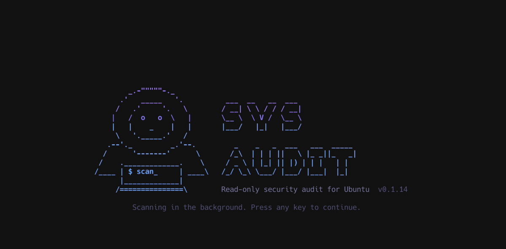
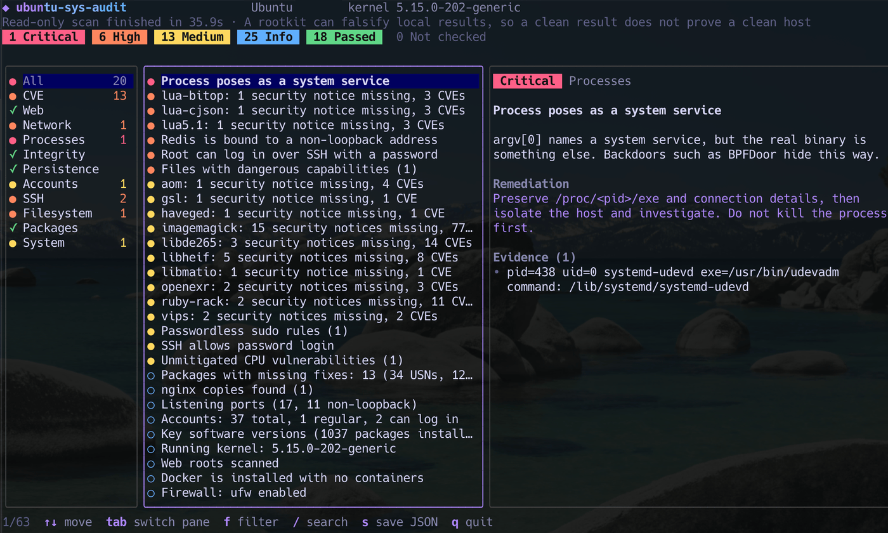

# ubuntu-sys-audit

[](https://github.com/guanting112/ubuntu-sys-audit/actions/workflows/release.yml)
[](https://github.com/guanting112/ubuntu-sys-audit/releases/latest)
[](LICENSE)
[](go.mod)
[](https://github.com/guanting112/ubuntu-sys-audit/attestations)
[](#quick-start)
[](#quick-start)

English | [繁體中文](README.zh-TW.md)



**A read-only security audit tool and CVE scanner for Ubuntu servers.**

`ubuntu-sys-audit` checks an Ubuntu 18.04, 20.04, 22.04, 24.04 or 26.04 host for missing CVE fixes, signs of compromise and risky configuration. It ships as a single static Go binary: download it, run it with sudo, and read the results in a terminal UI or as JSON. The host needs no agent, compiler or extra packages.

It helps answer questions like these, on one server or across a fleet:

- Which hosts still lack the fix for a new nginx, PHP or Linux kernel CVE?
- Does this host show signs of a backdoor, such as BPFDoor, a webshell, a reverse shell or a crypto miner?
- Who has root, sudo or SSH key access, and what is set to run at startup?
- Which hosts have pending security updates, need a reboot or run a release past its support date?



## Highlights

- **CVE results that account for backports.** Packages and the running kernel are compared against Canonical's Ubuntu Security Notices (USN) OVAL data, including fixes available only through ESM. A patched `nginx 1.18.0` is not reported just because of its version number.
- **Read-only.** It writes no files unless you ask and never executes a program from the host, so a replaced `ps` or `ss` cannot feed it false output.
- **Nothing to install.** One static binary for amd64 or arm64, with no agent or daemon.
- **Built for fleets.** Collect JSON reports over SSH and act on the exit code.
- **Works without internet access.** Point it at a local copy of the OVAL file.
- **Gentle on production.** It runs at low CPU and idle I/O priority and uses at most 2 CPUs.
- **Verifiable releases.** GitHub Actions builds the binaries and publishes build provenance attestations.

## Quick start

Each release has two binaries. Run `dpkg --print-architecture` on the host to see which one it needs:

| Output | Host | Binary |
|---|---|---|
| `amd64` | x86-64 | `ubuntu-sys-audit-linux-amd64` |
| `arm64` | 64-bit ARM | `ubuntu-sys-audit-linux-arm64` |

Other architectures, including 32-bit `armhf`, are not supported.

On amd64:

```sh
curl -fsSLO https://github.com/guanting112/ubuntu-sys-audit/releases/latest/download/ubuntu-sys-audit-linux-amd64
curl -fsSLO https://github.com/guanting112/ubuntu-sys-audit/releases/latest/download/SHA256SUMS
sha256sum --ignore-missing -c SHA256SUMS
chmod +x ubuntu-sys-audit-linux-amd64
sudo ./ubuntu-sys-audit-linux-amd64
```

On arm64:

```sh
curl -fsSLO https://github.com/guanting112/ubuntu-sys-audit/releases/latest/download/ubuntu-sys-audit-linux-arm64
curl -fsSLO https://github.com/guanting112/ubuntu-sys-audit/releases/latest/download/SHA256SUMS
sha256sum --ignore-missing -c SHA256SUMS
chmod +x ubuntu-sys-audit-linux-arm64
sudo ./ubuntu-sys-audit-linux-arm64
```

`SHA256SUMS` only catches a corrupted download, because it sits next to the binaries. To confirm a binary was built by this repository's workflow, for releases after v0.1.3:

```sh
gh attestation verify ubuntu-sys-audit-linux-amd64 -R guanting112/ubuntu-sys-audit   # amd64
gh attestation verify ubuntu-sys-audit-linux-arm64 -R guanting112/ubuntu-sys-audit   # arm64
```

Other examples in this README use the amd64 name. On ARM hosts, use `ubuntu-sys-audit-linux-arm64` instead.

### Scan multiple Ubuntu servers over SSH

The tool writes JSON automatically when there is no TTY, so you can collect reports over SSH:

```sh
for h in web-01 web-02 db-01; do
  ssh "$h" 'sudo "./ubuntu-sys-audit-linux-$(dpkg --print-architecture)"' > "audit-$h.json"
  echo "$h exit=$?"
done
```

`dpkg --print-architecture` runs on each host, so the loop works across amd64 and arm64 hosts as long as each one has its matching binary.

The loop requires passwordless sudo on the host. If sudo asks for a password, allocate a TTY and save the report to a file, then fetch it. A TTY would otherwise mix the password prompt into stdout:

```sh
ssh -t "$h" 'sudo "./ubuntu-sys-audit-linux-$(dpkg --print-architecture)" --json -o audit.json > /dev/null'
scp "$h:audit.json" "audit-$h.json"
```

The report has mode 0600 and its owner is set back to the user who ran sudo, so scp can fetch it directly. `-o` only creates new files, so remove an old report first. Under sudo, the directory must be one the invoking user can write to.

Use the exit code to decide what to do next:

| Code | Meaning |
| --- | --- |
| 0 | Nothing to act on |
| 1 | Medium findings |
| 2 | Critical or high findings |
| 3 | Scan incomplete: some items could not be checked, so do not treat the host as clean |
| 130 | Scan was aborted |

### Options

| Option | Description |
| --- | --- |
| `--json` | Write JSON to stdout without opening the TUI |
| `--text` | Write plain text to stdout without opening the TUI |
| `--min-severity LV` | In text mode, list only this level and above: `critical`, `high`, `medium`, `info`, `ok` (default `medium`). Items that could not be checked are always listed |
| `-o, --output FILE` | Also save the JSON report to a new FILE (mode 0600). An existing file is never overwritten |
| `--offline` | Do not use the network. CVEs are not checked unless `--oval-file` is given |
| `--oval-file PATH` | Use a local OVAL file (`.xml` or `.xml.bz2`) |
| `--proxy URL` | HTTP proxy for downloading advisory data |
| `--skip-fs` | Skip the full filesystem scan |
| `--fs-timeout TIME` | Time limit for the full filesystem scan (default `5m`) |
| `--no-netlink` | Do not read BPF filters, which keeps the kernel from loading `packet_diag` |
| `--version` | Show the version |

### TUI keys

`↑↓` or `jk` move · `tab` switch pane · `f` filter by severity · `/` search · `s` save JSON to the current directory · `q` quit

The opening screen disappears on its own after a moment, or on any key. The scan is already running behind it, so it costs no time.

## What it checks

| Category | Coverage |
| --- | --- |
| CVE | Installed packages and the running kernel against Ubuntu Security Notices (USN), including fixes available only through ESM. The LXD snap, which USN does not cover, against Canonical's LXD advisories |
| Web | nginx and PHP versions and origin; non-Ubuntu builds against nginx.org and php.net; common dangerous settings; webshell signatures; PHP files in upload directories |
| Network | Port 53 listeners and their owners, traffic to DNS servers the system is not configured to use, all listening ports, packet and raw sockets, BPFDoor magic values, promiscuous mode, MPTCP enabled (recommends disabling it), rarely used protocols (DCCP, SCTP, RDS, TIPC), ufw's default policy and IPv6 gaps, Docker and container ports that bypass ufw, tunnel interfaces and the programs holding them, unexplained IP forwarding, default routes, `/etc/hosts` overrides of Ubuntu domains, LXD API exposure and privileged LXD containers |
| Processes | Processes posing as kernel threads or system services, execution from temporary directories or memory, reverse shells, shells under web services, crypto miners, LD_PRELOAD, hidden processes, libraries replaced on disk but still in use |
| Integrity | System binaries against dpkg hashes, `ld.so.preload`, hidden kernel modules, unsigned modules, PAM modules and configuration, NSS modules, `core_pattern`, the `modprobe` path |
| Persistence | cron, at, rc.local, init.d, profile, motd, apt hooks, udev, login scripts in home directories, TCP Wrappers commands. For systemd: services and user units, generators and their output, transient units, lingering users, `LD_PRELOAD` and similar variables in units and environment files, drop-ins that replace the `ExecStart` of a package's service |
| Accounts | Account count and list, UID 0 accounts, empty passwords, sudo rules, privileged groups, login history, SSH brute force attempts |
| SSH | Effective `sshd_config` settings, authorized keys with fingerprints, keys on system accounts, host key permissions |
| Filesystem | SUID and SGID files, capabilities, executables in temporary directories, regular files in `/dev`, world-writable system files, system binaries not managed by a package |
| Packages | Pending security updates, stale apt lists, automatic updates, apt holds, third-party sources, versions of key software |
| System | Release support dates and ESM, kernel version, pending reboots, kernel security parameters, unprivileged user namespaces, CPU vulnerability mitigations |

## How it compares

`ubuntu-sys-audit` is a triage tool for Ubuntu hosts. It complements these widely used tools rather than replacing them:

| Tool | Main focus |
| --- | --- |
| `ubuntu-sys-audit` | Ubuntu CVE status, signs of compromise and risky configuration in one read-only run |
| Lynis | System hardening and compliance auditing on Linux and Unix |
| rkhunter, chkrootkit | Rootkit detection |
| Trivy | Vulnerabilities and misconfigurations in container images, filesystems and code repositories |

## Design principles

**Read-only.** The tool writes no files unless you pass `-o` or press `s`. Although it runs as root, it never executes a program from the host. Versions are read from the contents of binaries instead of running `nginx -v`. `test/e2e/run.sh` verifies this with strace.

Known exception: when the tool reads BPF filters, the kernel may automatically load the `packet_diag` module, the same effect as running `ss -0`. The report says so when this happens, and `--no-netlink` turns it off.

**Outbound traffic only downloads public data.** The tool connects to `security-metadata.canonical.com`, `nginx.org`, `www.php.net`, `api.github.com` and `api.snapcraft.io` using plain GET requests that send no information about the host. It contacts nginx.org and php.net only when it finds non-Ubuntu builds, and the last two only when it finds LXD.

**CVE checks do not rely on version numbers alone.** Ubuntu backports fixes to older versions, so `nginx 1.18.0` may already be patched. Apt packages are always compared against Canonical's OVAL data. Only self-compiled, upstream repository and PPA builds are compared against upstream advisories.

**Gentle on production.** The tool lowers its threads to low CPU priority and idle I/O, and uses at most 2 CPUs. In testing, most scans finished within 5 to 60 seconds, and the slowest took about 2.5 minutes when the OVAL download was slow. The test containers hold few files, so the full filesystem scan will take longer on hosts with many files (see `--fs-timeout` for the limit).

**Defends against hostile content on the host.** It does not follow symlinks into files users control: a link inside a home directory is reported, not read. FIFOs and devices are refused without being opened. Terminal control characters in host details, process names and file names are escaped. Password hashes from `/etc/passwd` and `/etc/shadow` are discarded on reading, keeping only the account status and algorithm. Common forms of credentials in command lines and configuration are masked, but this cannot catch every form, so treat reports as sensitive.

## Limitations

- **A clean result does not prove a clean host.** If a rootkit controls the kernel, anything a local tool sees may be falsified. The hidden process and hidden module checks catch common techniques, not all of them. If you suspect a compromise, boot from clean media and perform offline forensics.
- **Not checked does not mean passed.** Items that lacked permission, timed out or could not reach the network are shown as "Not checked" (`skipped` in JSON), never count as passed, and make the exit code 3 unless there are critical or high findings. A check that runs out of time keeps what it already found.
- **USN data covers only vulnerabilities Ubuntu has already fixed, and only apt packages.** Unpatched CVEs and packages from snap, pip, npm or container images are out of scope.
- **Hash checks trust the local dpkg database.** An attacker who also modifies the database will not be detected by this check.
- **Webshell detection is signature based.** It catches common samples, not customized or obfuscated ones.
- **Firewall rules are not evaluated.** The tool reads ufw's default policy and IPv6 setting, but does not run `iptables` or `nft` and cannot see cloud security groups, so "bound to a non-loopback address" does not necessarily mean reachable from outside.
- **Livepatch is not taken into account.** Kernel results compare versions, so CVEs already fixed by Livepatch may still be listed.
- **Detection is tested with planted samples.** `make e2e` plants fake backdoors in a container for each Ubuntu release. It does not exercise real rootkits.

## Hosts without internet access

On a machine with internet access, download the OVAL file for the host's release, copy it over and point the tool at it:

```sh
# bionic=18.04  focal=20.04  jammy=22.04  noble=24.04  resolute=26.04
curl -fsSLO https://security-metadata.canonical.com/oval/com.ubuntu.jammy.usn.oval.xml.bz2
sudo ./ubuntu-sys-audit-linux-amd64 --offline --oval-file com.ubuntu.jammy.usn.oval.xml.bz2
```

The report warns you when the data is more than 14 days old.

## FAQ

### How do I check an Ubuntu server for missing CVE patches?

Run the binary with sudo, as shown in [Quick start](#quick-start). It compares installed packages and the running kernel against Canonical's USN data, including fixes available only through ESM, and lists the matching notices.

### How do I check whether nginx or PHP is vulnerable on Ubuntu?

Comparing version numbers is not enough, because Ubuntu backports fixes: `nginx 1.18.0` may already be patched. Apt packages are compared against Canonical's OVAL data. Self-compiled, upstream repository and PPA builds are compared against data from nginx.org and php.net. The tool also reports common dangerous settings, webshell signatures and PHP files in upload directories.

### Can it detect BPFDoor?

It reads the BPF filters on packet sockets, the same data as `ss -0pb`, and reports a filter containing published BPFDoor magic values as critical. A variant with other values will not match that rule, but unpackaged programs that hold packet sockets and unknown processes that filter port 53 are still reported. Processes posing as kernel threads or system services are reported too.

### Is it safe to run on a production server?

The scan is read-only and runs at low CPU and idle I/O priority, using at most 2 CPUs. The one known side effect is that the kernel may load the `packet_diag` module, the same as running `ss -0`, and `--no-netlink` turns that off. On hosts with many files, limit the filesystem scan with `--fs-timeout` or skip it with `--skip-fs`.

### Does it send information about my host anywhere?

No. It only downloads public advisory data, using plain GET requests that send no information about the host. `--offline` stops it from using the network at all. [Design principles](#design-principles) lists every server it contacts.

### Can it scan a server without internet access?

Yes. Copy Canonical's OVAL file to the host and pass `--offline --oval-file`. See [Hosts without internet access](#hosts-without-internet-access).

### Do I need root?

Run it with sudo for full coverage. Without root it still runs, but items it cannot read are marked "Not checked" and the report warns you.

### Does it work on Debian or other distributions?

It is built and validated only for the Ubuntu releases listed above. On anything else, the report warns that the tool has not been validated there.

### Does a clean result mean the host was not compromised?

No. A rootkit that controls the kernel can falsify anything a local tool sees, and signature checks miss customized samples. If you suspect a compromise, boot from clean media and perform offline forensics. See [Limitations](#limitations).

## Development

```sh
make build   # Build into dist/ and generate SHA256SUMS
make test    # Unit tests (requires Docker)
make e2e     # Boot a container per Ubuntu release, plant fake backdoors and verify detection
```

The code only compiles for Linux. When developing on macOS, set `GOOS` to `linux` in your editor and add `GOOS=linux` to `go build` and `go vet`.

`test/e2e/plant.sh` creates a UID 0 account and SUID shells. Run it only inside the test container; the script refuses to run anywhere else.

## Releasing

Push a tag starting with `v`, and GitHub Actions builds both architectures and creates a release:

```sh
git tag v0.1.0 && git push origin v0.1.0
```

## License

[MIT](LICENSE)
