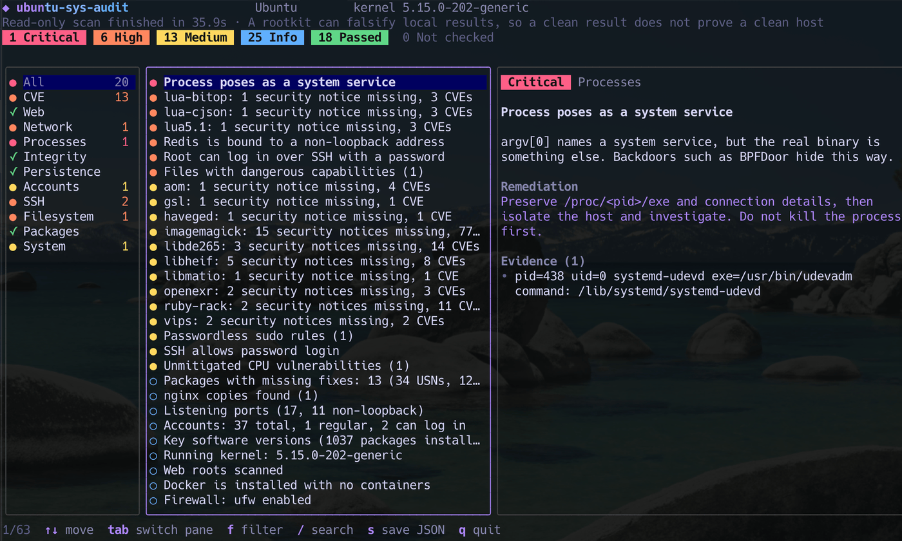
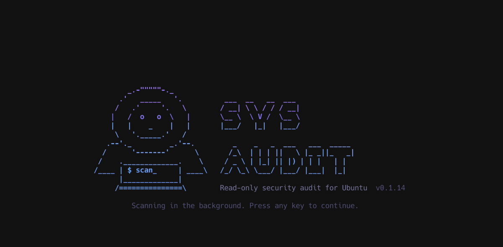

# ubuntu-sys-audit

[](https://github.com/guanting112/ubuntu-sys-audit/actions/workflows/release.yml)
[](https://github.com/guanting112/ubuntu-sys-audit/releases/latest)
[](LICENSE)
[](go.mod)
[](https://github.com/guanting112/ubuntu-sys-audit/attestations)
[](#快速開始)
[](#快速開始)

[English](README.md) | 繁體中文

**Ubuntu 主機的唯讀安全檢測工具與 CVE 弱點掃描器。**

`ubuntu-sys-audit` 會檢查 Ubuntu 18.04、20.04、22.04、24.04、26.04 主機是否缺少 CVE 修補、有沒有遭入侵的跡象，以及是否有高風險設定。它是單一靜態 Go 執行檔，下載後用 sudo 直接跑，結果可以在終端機介面（TUI）查看，也可以輸出 JSON。目標主機不需要安裝 agent、編譯器或任何套件。

工具的 TUI 與報告內容都是英文。

它可以回答這類問題，一台或整批主機都適用：

- 新的 nginx、PHP 或 Linux kernel CVE 出來後，哪些主機還沒修補？
- 這台主機有沒有後門跡象，例如 BPFDoor、webshell、reverse shell 或挖礦程式？
- 誰有 root、sudo 或 SSH 金鑰權限？開機時會自動執行哪些東西？
- 哪些主機有待安裝的安全更新、需要重開機，或版本已超過支援期限？





## 特色

- **CVE 結果會考慮 backport。** 已安裝套件與執行中 kernel 會比對 Canonical 的 Ubuntu 安全公告（USN）OVAL 資料，包含只有 ESM 才有的修補。已修補的 `nginx 1.18.0` 不會只因為版本號就被回報。
- **唯讀。** 除非你要求，否則不寫入任何檔案，也不會執行主機上的任何程式，所以被換掉的 `ps` 或 `ss` 無法提供假結果給它。
- **不用安裝。** amd64 和 arm64 各一個靜態執行檔，沒有 agent，也沒有常駐程式。
- **適合批次掃描。** 透過 SSH 收集 JSON 報告，再依結束代碼決定下一步。
- **可離線使用。** 指定本機的 OVAL 檔就能比對 CVE。
- **對生產環境溫和。** 以低 CPU 優先權與 idle I/O 執行，最多使用 2 個 CPU。
- **發布來源可驗證。** 執行檔由 GitHub Actions 編譯，並附上 build provenance attestation。

## 快速開始

每個 Release 都有兩個執行檔。在主機上執行 `dpkg --print-architecture`，就知道該用哪一個：

| 輸出 | 主機 | 執行檔 |
|---|---|---|
| `amd64` | x86-64 | `ubuntu-sys-audit-linux-amd64` |
| `arm64` | 64 位元 ARM | `ubuntu-sys-audit-linux-arm64` |

不支援其他架構，包括 32 位元的 `armhf`。

amd64 主機：

```sh
curl -fsSLO https://github.com/guanting112/ubuntu-sys-audit/releases/latest/download/ubuntu-sys-audit-linux-amd64
curl -fsSLO https://github.com/guanting112/ubuntu-sys-audit/releases/latest/download/SHA256SUMS
sha256sum --ignore-missing -c SHA256SUMS
chmod +x ubuntu-sys-audit-linux-amd64
sudo ./ubuntu-sys-audit-linux-amd64
```

arm64 主機：

```sh
curl -fsSLO https://github.com/guanting112/ubuntu-sys-audit/releases/latest/download/ubuntu-sys-audit-linux-arm64
curl -fsSLO https://github.com/guanting112/ubuntu-sys-audit/releases/latest/download/SHA256SUMS
sha256sum --ignore-missing -c SHA256SUMS
chmod +x ubuntu-sys-audit-linux-arm64
sudo ./ubuntu-sys-audit-linux-arm64
```

`SHA256SUMS` 和執行檔放在一起，只能抓出下載損毀。要確認執行檔確實由這個 repo 的 workflow 編譯（v0.1.3 之後的版本）：

```sh
gh attestation verify ubuntu-sys-audit-linux-amd64 -R guanting112/ubuntu-sys-audit   # amd64
gh attestation verify ubuntu-sys-audit-linux-arm64 -R guanting112/ubuntu-sys-audit   # arm64
```

本文件其他範例用的是 amd64 的檔名，ARM 主機請改用 `ubuntu-sys-audit-linux-arm64`。

### 透過 SSH 批次掃描多台 Ubuntu 主機

沒有 TTY 時會自動輸出 JSON，所以可以直接透過 SSH 收集：

```sh
for h in web-01 web-02 db-01; do
  ssh "$h" 'sudo "./ubuntu-sys-audit-linux-$(dpkg --print-architecture)"' > "audit-$h.json"
  echo "$h exit=$?"
done
```

`dpkg --print-architecture` 會在各台主機上執行，所以只要每台都放好對應的執行檔，amd64 和 arm64 主機可以一起掃。

上面的迴圈需要主機上的 sudo 免密碼。如果 sudo 要輸入密碼，就要配置 TTY，並把報告存成檔案再取回，因為 TTY 會把 stdout 和密碼提示混在一起：

```sh
ssh -t "$h" 'sudo "./ubuntu-sys-audit-linux-$(dpkg --print-architecture)" --json -o audit.json > /dev/null'
scp "$h:audit.json" "audit-$h.json"
```

報告權限是 0600，擁有者會設回執行 sudo 的使用者，所以 scp 可以直接取回。`-o` 只會建立新檔案，舊報告要先刪除；在 sudo 底下，目錄也必須是執行 sudo 的使用者寫得進去的。

結束代碼可以直接用來判斷：

| 代碼 | 意義 |
| --- | --- |
| 0 | 沒有待處理項目 |
| 1 | 有中等級項目 |
| 2 | 有嚴重或高等級項目 |
| 3 | 掃描不完整：有項目未能檢查，不要當成主機沒問題 |
| 130 | 掃描被中止 |

### 選項

| 選項 | 說明 |
| --- | --- |
| `--json` | 輸出 JSON 到 stdout，不開 TUI |
| `--text` | 輸出純文字到 stdout，不開 TUI |
| `--min-severity LV` | 純文字模式只列出此等級以上：`critical`、`high`、`medium`、`info`、`ok`（預設 `medium`）。未能檢查的項目一律會列出 |
| `-o, --output FILE` | 另外把 JSON 報告存成新檔案 FILE（權限 0600），不會覆寫既有檔案 |
| `--offline` | 不連網。沒有指定 `--oval-file` 時，不比對 CVE |
| `--oval-file PATH` | 使用本機的 OVAL 檔（`.xml` 或 `.xml.bz2`） |
| `--proxy URL` | 下載公告資料時使用的 HTTP proxy |
| `--skip-fs` | 略過全機檔案掃描 |
| `--fs-timeout TIME` | 全機檔案掃描的時間上限（預設 `5m`） |
| `--no-netlink` | 不讀取 BPF 過濾器，避免 kernel 載入 `packet_diag` |
| `--version` | 顯示版本 |

### TUI 按鍵

`↑↓` 或 `jk` 移動 · `tab` 切換窗格 · `f` 篩選嚴重度 · `/` 搜尋 · `s` 存 JSON 到目前目錄 · `q` 離開

開場畫面會自動消失，也可以按任意鍵跳過。掃描在背景同時進行，不會多花時間。

## 檢查項目

| 類別 | 內容 |
| --- | --- |
| CVE | 已安裝套件與執行中 kernel 比對 Ubuntu USN，包含只有 ESM 才有的修補；USN 涵蓋不到的 LXD snap 則比對 Canonical 的 LXD 公告 |
| Web | nginx、PHP 的版本與來源；非 Ubuntu 套件比對 nginx.org 與 php.net；常見危險設定；webshell 特徵；上傳目錄內的 PHP |
| 網路 | 53 Port 監聽與擁有者、連到非系統 DNS 的流量、所有監聽 Port、Packet 與 Raw socket、BPFDoor 特徵值、混雜模式、MPTCP 是否啟用（建議關閉）、Docker、LXD API 是否對外與特權容器 |
| 程序 | 偽裝成 kernel thread 或系統服務、從暫存目錄或記憶體執行、reverse shell、Web 服務底下的 shell、挖礦程式、LD_PRELOAD、隱藏程序、已被更新但仍在使用的函式庫 |
| 完整性 | 系統執行檔與 dpkg 雜湊比對、`ld.so.preload`、隱藏的 kernel 模組、未簽章模組、PAM 模組與設定、`core_pattern`、`modprobe` 路徑 |
| 持久化 | cron、at、rc.local、init.d、profile、motd、apt hook、udev、systemd 服務、家目錄登入腳本 |
| 帳號 | 帳號數量與清單、UID 0 帳號、空白密碼、sudo 規則、高權限群組、登入紀錄、SSH 暴力嘗試 |
| SSH | `sshd_config` 有效設定、授權金鑰清單與指紋、系統帳號的金鑰、host key 權限 |
| 檔案 | SUID／SGID、Capabilities、暫存目錄的執行檔、`/dev` 內的一般檔案、任何人可寫的系統檔、非套件管理的系統執行檔 |
| 套件 | 待安裝的安全更新、apt 清單是否過舊、自動更新、apt hold、第三方來源、重要軟體版本 |
| 系統 | 版本支援期限與 ESM、kernel 版本、是否需要重開機、kernel 安全參數、CPU 漏洞緩解 |

## 和其他工具的差異

`ubuntu-sys-audit` 是給 Ubuntu 主機做初步判斷的工具，用來搭配這些常見工具，不是取代它們：

| 工具 | 主要用途 |
| --- | --- |
| `ubuntu-sys-audit` | 一次唯讀掃描，檢查 Ubuntu 的 CVE 修補狀況、入侵跡象與高風險設定 |
| Lynis | Linux 與 Unix 的系統強化與合規稽核 |
| rkhunter、chkrootkit | Rootkit 偵測 |
| Trivy | 容器映像、檔案系統與程式碼 repo 的弱點與錯誤設定 |

## 設計原則

**唯讀。** 工具不會寫入任何檔案，除非你用 `-o` 或按 `s`。以 root 執行時也不會 exec 主機上的任何程式，版本是直接從執行檔內容讀出來的，不會跑 `nginx -v`。`test/e2e/run.sh` 會用 strace 驗證這一點。

已知例外：讀取 BPF 過濾器時，kernel 可能自動載入 `packet_diag` 模組，效果和執行 `ss -0` 相同。發生時報告會註明，也可以用 `--no-netlink` 關閉。

**對外連線只下載公開資料。** 連線對象是 `security-metadata.canonical.com`、`nginx.org`、`www.php.net`、`api.github.com` 和 `api.snapcraft.io`，都是單純的 GET，不會傳送主機資訊。其中 nginx.org 和 php.net 只有在發現非 Ubuntu 套件時才會連線，後兩個則只有在發現 LXD 時才會連線。

**CVE 不只比版本號。** Ubuntu 會把修補 backport 到舊版本，`nginx 1.18.0` 可能早已修補，所以 apt 套件一律比對 Canonical 的 OVAL 資料。自行編譯、官方套件庫或 PPA 的版本才比對上游公告。

**對生產環境溫和。** 工具會把執行緒調成低 CPU 優先權與 idle I/O，並限制最多使用 2 個 CPU。測試時多數掃描在 5 到 60 秒內完成，下載 OVAL 較慢時最久約 2.5 分鐘；測試用容器的檔案不多，檔案很多的主機在全機掃描上會花更久（上限見 `--fs-timeout`）。

**防範來自主機的惡意內容。** 不會跟著 symlink 讀取使用者可控制的檔案：家目錄裡的連結只會回報，不會讀取；FIFO 和裝置檔不會被開啟。主機資訊、process 名稱與檔名內的終端機控制字元會被轉義。`/etc/passwd` 和 `/etc/shadow` 的密碼雜湊讀取後立即丟棄，只保留狀態與演算法。指令列與設定內常見形式的帳密會被遮罩，但無法涵蓋所有寫法，報告仍要當成敏感資料保管。

## 使用限制

- **未發現異常不代表主機乾淨。** 如果 kernel 已被 rootkit 控制，本機工具看到的結果都可能被竄改。隱藏程序與隱藏模組的檢查能抓到常見手法，抓不到全部。懷疑遭入侵時，請從乾淨媒體開機做離線鑑識。
- **未檢查不等於通過。** 權限不足、逾時或連不上網路的項目會標示「Not checked」（JSON 內是 `skipped`），不會算成通過；沒有嚴重或高等級項目時，結束代碼會是 3。檢查逾時也會保留已找到的結果。
- **USN 只涵蓋 Ubuntu 已發布修補的漏洞與 apt 套件。** 還沒有修補的 CVE、snap、pip、npm、容器映像內的套件都不在比對範圍內。
- **雜湊比對的基準是本機 dpkg 資料庫。** 攻擊者若連資料庫一起改，這項就驗不出來。
- **webshell 檢查是特徵比對。** 能抓到常見樣本，抓不到客製或混淆過的版本。
- **防火牆只回報狀態。** 工具不會執行 `iptables` 或 `nft`，也看不到雲端安全群組，所以「綁定在非 loopback」不等於真的對外開放。
- **Livepatch 不會納入判斷。** kernel 項目比對的是版本，已由 Livepatch 修補的 CVE 仍可能列出。
- **偵測是用植入的樣本測試的。** `make e2e` 會在每個 Ubuntu 版本的容器裡植入假後門，沒有用真實的 rootkit 測試。

## 無法對外連線的主機

在有網路的機器下載對應版本的 OVAL 檔，複製過去後指定：

```sh
# bionic=18.04  focal=20.04  jammy=22.04  noble=24.04  resolute=26.04
curl -fsSLO https://security-metadata.canonical.com/oval/com.ubuntu.jammy.usn.oval.xml.bz2
sudo ./ubuntu-sys-audit-linux-amd64 --offline --oval-file com.ubuntu.jammy.usn.oval.xml.bz2
```

資料超過 14 天時，報告會提醒你。

## 常見問題

### 怎麼檢查 Ubuntu 主機缺少哪些 CVE 修補？

依照[快速開始](#快速開始)用 sudo 執行即可。工具會把已安裝套件與執行中 kernel 比對 Canonical 的 USN 資料，包含只有 ESM 才有的修補，並列出對應的公告。

### 怎麼確認 Ubuntu 上的 nginx 或 PHP 有沒有漏洞？

只比版本號不夠，因為 Ubuntu 會 backport 修補，`nginx 1.18.0` 可能早已修補。apt 套件會比對 Canonical 的 OVAL 資料；自行編譯、官方套件庫或 PPA 的版本則比對 nginx.org 與 php.net 的資料。工具也會回報常見危險設定、webshell 特徵，以及上傳目錄內的 PHP 檔案。

### 能偵測 BPFDoor 嗎？

工具會讀取 packet socket 上的 BPF 過濾器，資料和 `ss -0pb` 相同；過濾器含有已公開的 BPFDoor 特徵值時，會回報為 Critical。使用其他特徵值的變種不會符合這條規則，但持有 packet socket 的非套件程式，以及過濾 53 Port 的不明程序仍會被回報。偽裝成 kernel thread 或系統服務的程序也會被回報。

### 可以在生產環境執行嗎？

掃描是唯讀的，並以低 CPU 優先權與 idle I/O 執行，最多使用 2 個 CPU。已知唯一的副作用是 kernel 可能載入 `packet_diag` 模組，效果和執行 `ss -0` 相同，可以用 `--no-netlink` 關閉。檔案很多的主機可以用 `--fs-timeout` 限制全機掃描時間，或用 `--skip-fs` 略過。

### 會把主機資訊傳到外面嗎？

不會。工具只用單純的 GET 下載公開的公告資料，不會傳送主機資訊。`--offline` 可以完全不連網。連線對象都列在[設計原則](#設計原則)。

### 無法對外連線的主機也能掃描嗎？

可以。把 Canonical 的 OVAL 檔複製到主機上，再加上 `--offline --oval-file`。詳見[無法對外連線的主機](#無法對外連線的主機)。

### 一定要 root 嗎？

要完整檢查就請用 sudo 執行。沒有 root 也能跑，但讀不到的項目會標示「Not checked」，報告也會提醒你。

### 可以用在 Debian 或其他發行版嗎？

工具只針對上面列出的 Ubuntu 版本開發與驗證。在其他系統上，報告會提醒工具尚未在該系統驗證過。

### 掃描沒發現問題，就代表主機沒被入侵嗎？

不代表。控制 kernel 的 rootkit 可以竄改本機工具看到的任何結果，特徵比對也抓不到客製樣本。懷疑遭入侵時，請從乾淨媒體開機做離線鑑識。詳見[使用限制](#使用限制)。

## 開發

```sh
make build   # 編譯到 dist/，並產生 SHA256SUMS
make test    # 單元測試（需要 Docker）
make e2e     # 每個 Ubuntu 版本都開容器、植入假後門並驗證偵測結果
```

程式只能在 Linux 上編譯，在 macOS 開發時請把編輯器的 `GOOS` 設為 `linux`，`go build` 與 `go vet` 也要加上 `GOOS=linux`。

`test/e2e/plant.sh` 會建立 UID 0 帳號與 SUID shell，只能在測試容器內執行，腳本也會拒絕在其他環境執行。

## 發布

推送 `v` 開頭的 tag，GitHub Actions 就會編譯兩種架構並建立 Release：

```sh
git tag v0.1.0 && git push origin v0.1.0
```

## 授權

[MIT](LICENSE)
